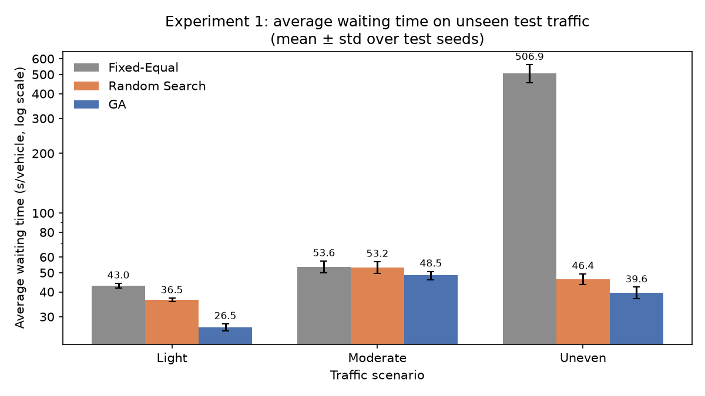
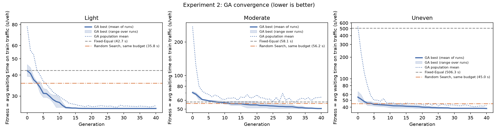
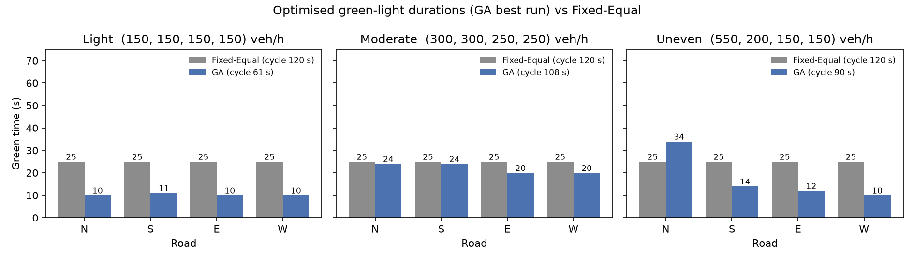
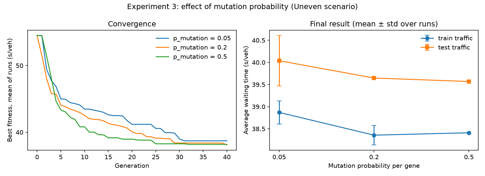

# Traffic Signal Timing Optimization Using Genetic Algorithms: A Simulation-Based Comparative Study

*Report material for the Soft Computing course project. Every number in this report comes from
executing `Traffic_Signal_GA.ipynb` (equivalently `python run_experiments.py`). The tables are in
`results/` and the plots are in `figures/`.*

---

## 1. Abstract

Fixed-time traffic signals are often given equal or hand-tuned green times. When traffic on the
roads is unbalanced or light, such settings make vehicles wait unnecessarily.

This project applies a **Genetic Algorithm (GA)**, a soft computing technique, to choose the four
green-light durations of an isolated four-way intersection. The aim is to minimise the average
vehicle waiting time.

- **Simulator.** A simple discrete-time queue simulator with synthetic Poisson traffic evaluates
  every candidate signal plan.
- **GA design.** The GA is implemented from scratch. It uses tournament selection, uniform
  crossover, Gaussian mutation, elitism and a repair operator that guarantees every plan satisfies
  the green-time and cycle-length constraints.
- **Baselines.** The GA is compared with an equal fixed-time controller and with Random Search
  given the same number of evaluations.
- **Protocol.** There are three traffic scenarios (Light, Moderate, Uneven). The GA optimises on
  three training traffic patterns and is tested on twenty different, unseen patterns.

**Results.** On the unseen traffic, the GA reduced the average waiting time compared with the
equal fixed-time signal by:
- **38.3 %** in Light traffic (43.0 → 26.5 s);
- **9.5 %** in Moderate traffic (53.6 → 48.5 s);
- **92.2 %** in Uneven traffic (506.9 → 39.6 s). Here the equal plan cannot serve the busiest road.

The GA also outperformed Random Search with the same budget in all scenarios.

The data is synthetic and the model is simplified, so the results demonstrate the method rather
than predict real-world performance.

---

## 2. Introduction

Traffic signals decide how long each road at an intersection may move. A common and simple
approach is the **fixed-time** signal, which repeats the same plan of green, amber and red
intervals all day.

If the green times do not match the traffic, two problems appear:
- a busy road gets too little green, so long queues build up;
- a quiet road keeps the green for longer than needed while others wait.

Choosing good green times is an **optimisation problem**. The quality of a plan (how long vehicles
wait) depends on random vehicle arrivals and on queue dynamics, and there is no simple exact
formula for it. It can, however, be measured by **simulation**. This makes the problem a natural
fit for a **Genetic Algorithm**: a population-based search inspired by natural evolution, which
needs only a way to score a candidate solution.

---

## 3. Problem Statement

For an isolated four-way intersection with North, South, East and West approaches, find the green-light
durations `[g_N, g_S, g_E, g_W]` that **minimise the average waiting time per vehicle**, subject to:

- each green time is a whole number of seconds with `10 ≤ g ≤ 60`;
- the cycle length `C = g_N + g_S + g_E + g_W + 20` satisfies `40 ≤ C ≤ 180` s (20 s is the
  lost time for amber and all-red).

The solution must then be compared fairly against a conventional equal fixed-time controller under
several traffic conditions.

---

## 4. Objectives

1. Build a simple, documented simulator of a four-way signalised intersection that uses synthetic traffic.
2. Implement a Genetic Algorithm from scratch to optimise the four green times.
3. Guarantee that every solution the GA produces satisfies the timing constraints.
4. Compare the GA with a Fixed-Equal controller and with Random Search under the same budget,
   using **separate** training and test traffic.
5. Analyse the GA's convergence and the effect of the mutation probability.
6. Present the results with tables and labelled graphs.

---

## 5. Existing Approach and Proposed Approach

**Existing approach: fixed-time control with equal green times.** Every road receives the same
green time (here 25 s, giving a cycle of 120 s).
- It is simple and predictable.
- It ignores how much traffic each road actually carries.
- Traffic engineers also use classical formulas such as **Webster's method** (1958), which
  computes a cycle length and divides green time in proportion to demand. Webster's method relies
  on simplifying assumptions; it is mentioned here for context and was not implemented in this project.

**Proposed approach: GA-optimised fixed-time control.**
- A Genetic Algorithm searches for the green times that minimise simulated average waiting time
  for a given traffic pattern.
- The result is still a fixed-time plan, but one tuned to the demand.
- The optimisation is **offline**: the GA computes the plan in advance and does not adjust the
  signal in real time.

---

## 6. Soft Computing Technique Used

**Soft computing** is a family of techniques that tolerate imprecision, uncertainty and
approximation in order to find good solutions to problems that are hard to solve exactly. Examples
include genetic algorithms, fuzzy logic, neural networks and swarm intelligence.

This project uses a **Genetic Algorithm**, introduced by Holland (1975) and popularised by Goldberg (1989).
- A GA keeps a **population** of candidate solutions (chromosomes).
- It repeatedly creates a new generation by:
  - **selecting** good solutions as parents;
  - combining them by **crossover**;
  - making small random changes by **mutation**.

**Why a GA suits this problem**
- **Black-box objective.** The waiting time comes from a random simulation, so there is no formula
  and no gradient. A GA needs only fitness values.
- **Large discrete search space.** There are 51⁴ ≈ 6.8 million possible integer plans, and each
  evaluation costs a simulation, so exhaustive search is impractical.
- **Building blocks.** A good green time for one road can be inherited and combined with good green
  times for other roads through crossover.

---

## 7. System Architecture and Workflow

```
 Scenario (arrival rates per road)
        │
 Traffic generator (Poisson, seeded) ──► train traffic (seeds 0–2)  and  test traffic (seeds 1000–1019)
        │
 ┌──────┴─────────────────────────────────────────────┐
 │ Fixed-Equal plan (25,25,25,25)                     │
 │ GA ──────────────┐                                 │
 │ Random Search ───┴─► fitness = simulate on TRAIN   │
 └──────┬─────────────────────────────────────────────┘
        │  final plans
 Simulator on the same unseen TEST traffic ──► metrics ──► tables (results/) + plots (figures/)
```

| Module (in `traffic_ga.py` and in the notebook) | Role |
|---|---|
| Settings | Intersection parameters, constraints, seeds, GA parameters; validates that the constraints are feasible |
| Scenarios | Arrival rates for Light, Moderate and Uneven |
| Traffic generator | Per-second Poisson arrivals from a seed |
| Constraint handling | `is_valid()`, `repair()`, signal schedule |
| Simulator | Queue simulation and waiting-time metrics |
| Fitness | Average waiting time over training traffic, with a cache |
| Controllers | Fixed-Equal plan, random plan |
| GA / Random Search | The optimisers |
| Experiments / plots | Run the comparison, summarise, plot and save |

---

## 8. Methodology

1. **Define the scenarios**: three sets of arrival rates (Section 11).
2. **Generate synthetic traffic** with fixed random seeds:
   - **training** seeds 0, 1 and 2 are used only for optimisation;
   - **test** seeds 1000–1019 are used only for the final comparison.
3. **Score plans.** The fitness of a plan is its average waiting time over the three training
   patterns.
4. **Optimise.**
   - Run the GA **3 times** per scenario, with GA seeds 0, 1 and 2.
   - For each GA run, run Random Search with the same seed and **exactly the same number of
     distinct plans evaluated** as that GA run.
5. **Evaluate.**
   - Simulate the Fixed-Equal plan and every GA and Random Search plan on the **same 20 test
     patterns**.
   - Average the 3 runs per test pattern, then report the mean ± standard deviation over the 20
     patterns.
6. **Analyse** convergence (Experiment 2) and the mutation probability (Experiment 3).

**Fairness.** All controllers see exactly the same simulated vehicles, the same constraints and the
same simulator.
- **The only difference:** Fixed-Equal uses a preset plan, while the GA and Random Search choose
  their plan using the training traffic.
- **Why test traffic matters:** evaluating on separate test traffic checks that the GA's plan is
  genuinely good, not just tuned to the particular random vehicles it was trained on.

---

## 9. Genetic Algorithm Design

| Element | Design | Explanation |
|---|---|---|
| **Gene** | One green time in seconds | e.g. `g_N = 34` |
| **Chromosome** | `[g_N, g_S, g_E, g_W]` (integers) | One complete signal plan |
| **Population size** | 30 | Number of plans per generation |
| **Initial population** | 4 uniform random values in [10, 60], then repaired | Random, unbiased start |
| **Fitness** | Average waiting time (s/veh) over 3 training traffic patterns | **Minimised**: lower is better |
| **Selection** | Tournament, k = 3 | Pick 3 plans at random; the one with the lowest waiting time becomes a parent. Good plans are chosen more often, but weaker ones still get a chance, which preserves diversity. |
| **Crossover** | Uniform, probability 0.8 | For each of the 4 genes, a coin flip decides which parent the child copies it from; the second child gets the other parent's gene. With only 4 genes, this mixes the parents better than one-point crossover. |
| **Mutation** | Per gene, probability 0.2: add a random value from Normal(0, 5 s) | Small random changes explore nearby plans and keep diversity |
| **Constraint handling** | `repair()` after initialisation, crossover and mutation | Guarantees every plan is valid (see below) |
| **Elitism** | Best 2 plans copied unchanged | The best solution can never be lost, so best fitness never gets worse |
| **Termination** | 40 generations | — |
| **Fitness cache** | A plan already evaluated is not simulated again | Saves time; counts the distinct plans evaluated |

**Repair operator (constraint handling).**

The constraints imply that the sum of the greens must lie in `[S_lo, S_hi] = [40, 160]` s. A plan
is repaired in three steps:
1. Round each gene and clip it to [10, 60].
2. If the sum exceeds 160, remove the excess in proportion to each gene's slack (`g − 10`). If it is
   below 40, add the deficit in proportion to each gene's headroom (`60 − g`).
3. Leftover single seconds go to the genes with the largest fractional share.

**Why this always succeeds:**
- If the sum is above 160, the total slack is (sum − 40), which is larger than the excess (sum − 160).
- If the sum is below 40, the total headroom is (240 − sum), which is larger than the deficit (40 − sum).

The settings are checked at start-up (`validate_constraints`) so that this reasoning always holds.
The code also asserts validity before any plan is simulated, so **the GA cannot produce or evaluate
an invalid plan**.

**GA loop (pseudocode)**
```
population ← 30 random plans (repaired)
for generation = 0 … 40:
    evaluate fitness of every plan; record best / mean / worst
    if last generation: stop
    next ← the 2 best plans (elitism)
    while |next| < 30:
        p1, p2 ← tournament(3), tournament(3)
        c1, c2 ← uniform_crossover(p1, p2) with prob 0.8, else copies
        next ← next + [repair(mutate(c1)), repair(mutate(c2))]
    population ← next
return best plan found
```

---

## 10. Simulation Assumptions

**Signal and intersection**
- **Phases.** Four phases: one road has green at a time, in the order N → S → E → W.
- **Clearance intervals.** Each green is followed by 3 s amber and 2 s all-red, during which no
  vehicle departs. That gives 20 s of lost time per cycle.
- **Discharge rate.** Saturation flow is 1800 veh/h. A green road discharges one vehicle every 2 s
  while it has a queue, using a "departure credit" of 0.5 per green second.
- **Point queues.** Vehicles wait at the stop line in first-in-first-out order; the physical length
  of the queue is ignored.
- **One stream per road.** Each road is one stream of identical vehicles. There are no turning
  movements, pedestrians, buses or lane changes.

**Traffic**
- **Arrivals.** Poisson with a constant mean rate per road, simulated in 1-second steps.

**Measurement**
- **Timeline.** 300 s warm-up (not measured), a 3600 s measurement window, and a 600 s drain period.
- **Waiting time.** It is measured for vehicles arriving in the window, as departure time − arrival
  time.
- **Censored vehicles.** Vehicles still waiting at the end are counted with the time waited so far
  (`n_censored`).
- **Other metrics.** "Vehicles served" counts departures during the window. "Average queue" is the
  time-averaged number of waiting vehicles.

**Limitations of the simulation**
- It is a single isolated intersection with no effects from neighbouring signals.
- There is no start-up loss, and no acceleration or deceleration is modelled.
- Demand is constant over the hour (no peaks).
- The data is synthetic, not measured on a real road.
- The waiting time is a *simulated stop-line waiting time*. It is suitable for comparing plans with
  each other, but it is not the official delay measure of traffic-engineering manuals.

---

## 11. Experimental Setup

**Scenarios** (arrival rates in vehicles/hour; `Y = Σ rate / 1800` is the flow ratio):

| Scenario | N | S | E | W | Total | Y |
|---|---|---|---|---|---|---|
| Light | 150 | 150 | 150 | 150 | 600 | 0.333 |
| Moderate | 300 | 300 | 250 | 250 | 1100 | 0.611 |
| Uneven | 550 | 200 | 150 | 150 | 1050 | 0.583 |

A fixed-time plan can serve the demand only if `Y < 1 − 20/C`. For the longest allowed cycle
(180 s), that means Y < 0.889, which all scenarios satisfy.

**Parameters**

| Item | Value |
|---|---|
| Green limits | 10–60 s each |
| Cycle limits | 40–180 s (in practice 60–180 s, because of the 10 s minimum greens) |
| Fixed-Equal plan | 25/25/25/25 s (cycle 120 s) |
| GA | population 30, 40 generations, tournament k = 3, crossover 0.8, mutation 0.2 per gene (σ = 5 s), 2 elites |
| Random Search | Same number of distinct evaluated plans as the matching GA run |
| Training traffic | Seeds 0, 1, 2 |
| Test traffic | Seeds 1000–1019 (20 patterns) |
| Independent runs | 3 per optimiser per scenario |
| Software | Python 3, NumPy, Pandas, Matplotlib |
| Run time | About 1 minute for all experiments on a laptop CPU; about 2–3 minutes in Colab (estimate) |

---

## 12. Actual Results and Comparison

### Experiment 1: Controller comparison (unseen test traffic, mean ± std over 20 patterns)

| Scenario | Controller | Avg waiting time (s/veh) | Vehicles served (/h) | Avg queue (veh) | Still waiting at end | Improvement vs Fixed |
|---|---|---|---|---|---|---|
| Light | Fixed-Equal | 43.0 ± 1.2 | 609 | 7.3 | 0 | — |
| Light | Random Search | 36.5 ± 0.8 | 609 | 6.2 | 0 | 15.2 % |
| Light | **GA** | **26.5 ± 1.1** | 608 | 4.5 | 0 | **38.3 %** |
| Moderate | Fixed-Equal | 53.6 ± 3.7 | 1105 | 16.5 | 0 | — |
| Moderate | Random Search | 53.2 ± 3.7 | 1105 | 16.3 | 0 | 0.7 % |
| Moderate | **GA** | **48.5 ± 2.3** | 1107 | 14.9 | 0 | **9.5 %** |
| Uneven | Fixed-Equal | 506.9 ± 53.3 | 866 | 119.7 | 149.6 | — |
| Uneven | Random Search | 46.4 ± 2.9 | 1055 | 13.6 | 0 | 90.8 % |
| Uneven | **GA** | **39.6 ± 2.6** | 1056 | 11.6 | 0 | **92.2 %** |

**Plans found** (green times N/S/E/W in seconds, with cycle):

| Scenario | GA run 0 | GA run 1 | GA run 2 | Random Search (runs 0/1/2) |
|---|---|---|---|---|
| Light | 10/11/10/10 (61) | 10/11/10/10 (61) | 11/10/10/10 (61) | 13/21/14/18, 21/18/27/14, 23/18/19/25 |
| Moderate | 24/24/20/20 (108) | 22/26/22/20 (110) | 24/24/20/20 (108) | 29/30/31/26, 22/26/19/21, 21/22/22/20 |
| Uneven | 34/14/12/10 (90) | 34/14/12/10 (90) | 38/14/12/12 (96) | 42/21/17/16, 38/19/15/14, 53/24/14/19 |

**Budget.** Distinct plans evaluated per GA run (Random Search got exactly the same number):
- Light: 423, 373 and 343
- Moderate: 740, 601 and 657
- Uneven: 477, 541 and 690

**Comparison**
- **Light.** The GA chose the minimum greens, giving a 61 s cycle. With little traffic, a short cycle
  means vehicles wait less for their next green; the equal 120 s cycle wastes time.
- **Moderate.** The GA gave the busier North and South roads more green than East and West. The gain
  is smaller (9.5 %) because an equal plan is already reasonable for nearly balanced traffic.
- **Uneven.**
  - With 25 s of green per 120 s cycle, North can discharge only about 360 veh/h, but 550 veh/h
    arrive. North's queue grows continuously: about 150 measured vehicles per pattern were still
    waiting at the end, and only about 866 vehicles/h were served.
  - Fixed-Equal's 506.9 s is therefore a lower bound that would increase with a longer simulation.
  - The GA allocated 34 s to North and served about 1056 vehicles/h with no vehicles left waiting.
- **Vehicles served** is the same for all controllers in Light and Moderate, because every plan can
  serve that demand. The difference is in how long vehicles wait.
- **GA vs Random Search.** With an identical budget of distinct evaluations, the GA found better plans
  in every scenario. This shows that selection, crossover and mutation add value beyond random trial.
- **Consistency.** The 3 GA runs produced the same or very similar plans, so the result is not a
  lucky single run.

### Experiment 2: GA convergence (best fitness on training traffic, mean of 3 runs)

| Scenario | Generation 0 | Generation 10 | Generation 40 | Fixed-Equal (train) |
|---|---|---|---|---|
| Light | 42.48 | 27.46 | 25.29 | 42.67 |
| Moderate | 70.38 | 56.75 | 50.58 | 58.15 |
| Uneven | 55.28 | 42.32 | 38.36 | 506.33 |

### Experiment 3: Mutation probability (Uneven, 3 runs each)

| p_mutation | Train fitness | Test avg wait | Distinct plans evaluated |
|---|---|---|---|
| 0.05 | 38.87 ± 0.26 | 40.04 ± 0.57 | 228 ± 16 |
| 0.20 (default) | 38.36 ± 0.22 | 39.65 ± 0.00 | 569 ± 109 |
| 0.50 | 38.41 ± 0.00 | 39.57 ± 0.00 | 912 ± 59 |

---

## 13. Graphs and Their Interpretation

**Figure 1: `figures/e1_avg_wait_bars.png`.** Average waiting time per scenario and controller,
with error bars of ±1 std over the test patterns.
- The y-axis is logarithmic, because Fixed-Equal on Uneven (≈ 507 s) is more than ten times the other values.
- The GA bar is the lowest in every scenario. The improvement is largest in Uneven and Light, and
  smaller in Moderate.



**Figure 2: `figures/e2_convergence.png`.** Best fitness (solid line, mean of 3 runs, with a band
showing the range across runs) and population mean (dotted) against generation, with dashed lines
for Fixed-Equal and Random Search.
- **Does the GA improve?** Yes. The best fitness falls quickly during the first 10–15 generations
  and then levels off, which is typical convergence.
- **Population mean.** It falls steeply from very poor random plans as selection removes them.
- **Against the baselines.**
  - In Light and Uneven, even the best random initial plan beats Fixed-Equal.
  - In Moderate, the GA passes Fixed-Equal after about 8 generations.
  - It passes the Random Search result after about 4–12 generations.



**Figure 3: `figures/green_times.png`.** Green time per road for Fixed-Equal and the GA's best
plan. It shows *how* the GA improves:
- Light: shorter greens and a shorter cycle;
- Moderate: slightly more green to the busier N–S roads;
- Uneven: much more green to North.



**Figure 4: `figures/e3_mutation.png`.** Convergence (left) and final train and test waiting time
(right) for three mutation probabilities.
- **p = 0.05:** with very little mutation the population quickly fills with copies. The GA explores
  only about 230 distinct plans and ends slightly worse, with more variation between runs.
- **p = 0.5:** explores the most (about 900 plans), and all 3 runs reach the same plan.
- **Caveat:** the differences are small (under 0.5 s on test traffic) and come from 3 runs, so they
  are trends rather than proof. A moderate mutation rate balances exploration against keeping good
  solutions intact.



---

## 14. Advantages and Limitations

**Advantages**
- **No formula or gradient needed.** The GA works with any objective that can be simulated.
- **Adapts to demand.** It automatically gives more green to busier roads and shortens the cycle
  when traffic is light.
- **Constraints always respected.** The repair operator guarantees this, so no plan is invalid.
- **Robust results.** Independent runs produced consistent plans, and the gains held on unseen test traffic.
- **Simple and transparent.** It is implemented from scratch, so every step can be explained.
- **Easy to extend.** The fitness function could, for example, include queue length or fairness.

**Limitations**
- **Synthetic data.** Traffic is generated, not measured, so absolute numbers do not predict a real
  intersection.
- **Simplified simulator.** Point queues; no turns, pedestrians or vehicle types; constant demand.
- **Narrow scope.** A single isolated intersection, with no coordination between signals.
- **Offline fixed-time plan.** It does not react to traffic changes in real time.
- **Stochastic search.** The GA must be run several times. Optimising on only three training
  patterns carries some risk of tuning to them. In Light and Uneven, the GA's waiting time on test
  traffic was about 1 s higher than on its training traffic.
- **Computational cost.** Each fitness evaluation needs several simulations, which is more costly
  than a closed-form formula.

---

## 15. Conclusion and Future Scope

**Conclusion.** A Genetic Algorithm implemented from scratch, guided only by simulated waiting
times, found green-light durations that reduced the average waiting time on unseen synthetic traffic
compared with an equal fixed-time signal:
- by **38.3 %** in Light traffic;
- by **9.5 %** in Moderate traffic;
- by **92.2 %** in Uneven traffic, where the equal plan could not serve the busiest road at all.

The GA also beat Random Search under an identical evaluation budget. Most of its improvement came
within the first 10–15 generations, and independent runs reached consistent solutions. The largest benefits appear when traffic is unbalanced,
which is exactly where a one-size-fits-all signal setting performs worst.

**Future scope**
1. Time-varying demand (morning and evening peaks), with a different plan per time period.
2. Coordinating several intersections along a corridor (offsets and green waves).
3. A more detailed simulator (turning movements, lanes, start-up loss), or a tool such as SUMO.
4. Comparison with Webster's method and with other metaheuristics (PSO, simulated annealing).
5. Calibration with real traffic counts from an actual intersection.
6. Adaptive control that re-optimises as traffic measurements arrive.

---

## 16. References

*Check every reference against the original source before citing it.*

1. J. H. Holland, *Adaptation in Natural and Artificial Systems*. Ann Arbor: University of Michigan Press, 1975.
2. D. E. Goldberg, *Genetic Algorithms in Search, Optimization, and Machine Learning*. Reading, MA: Addison-Wesley, 1989.
3. M. Mitchell, *An Introduction to Genetic Algorithms*. Cambridge, MA: MIT Press, 1996.
4. F. V. Webster, "Traffic Signal Settings," Road Research Technical Paper No. 39, Road Research Laboratory, London: HMSO, 1958.
5. M. D. Foy, R. F. Benekohal, and D. E. Goldberg, "Signal timing determination using genetic algorithms," *Transportation Research Record*, no. 1365, pp. 108–115, 1992.
6. B. Park, C. J. Messer, and T. Urbanik II, "Traffic signal optimization program for oversaturated conditions: genetic algorithm approach," *Transportation Research Record*, no. 1683, pp. 133–142, 1999.
7. R. P. Roess, E. S. Prassas, and W. R. McShane, *Traffic Engineering*, 4th ed. Upper Saddle River, NJ: Pearson, 2011.
8. C. R. Harris *et al.*, "Array programming with NumPy," *Nature*, vol. 585, pp. 357–362, 2020.
